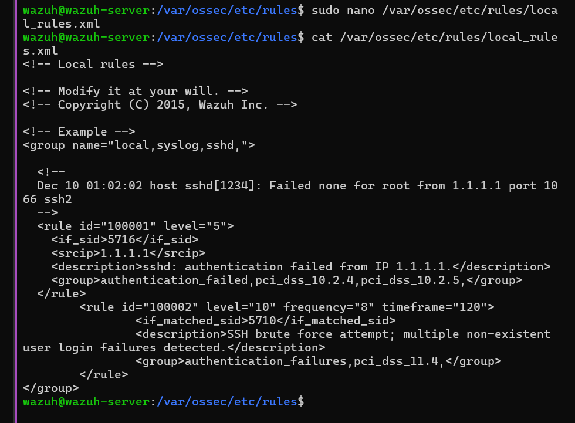
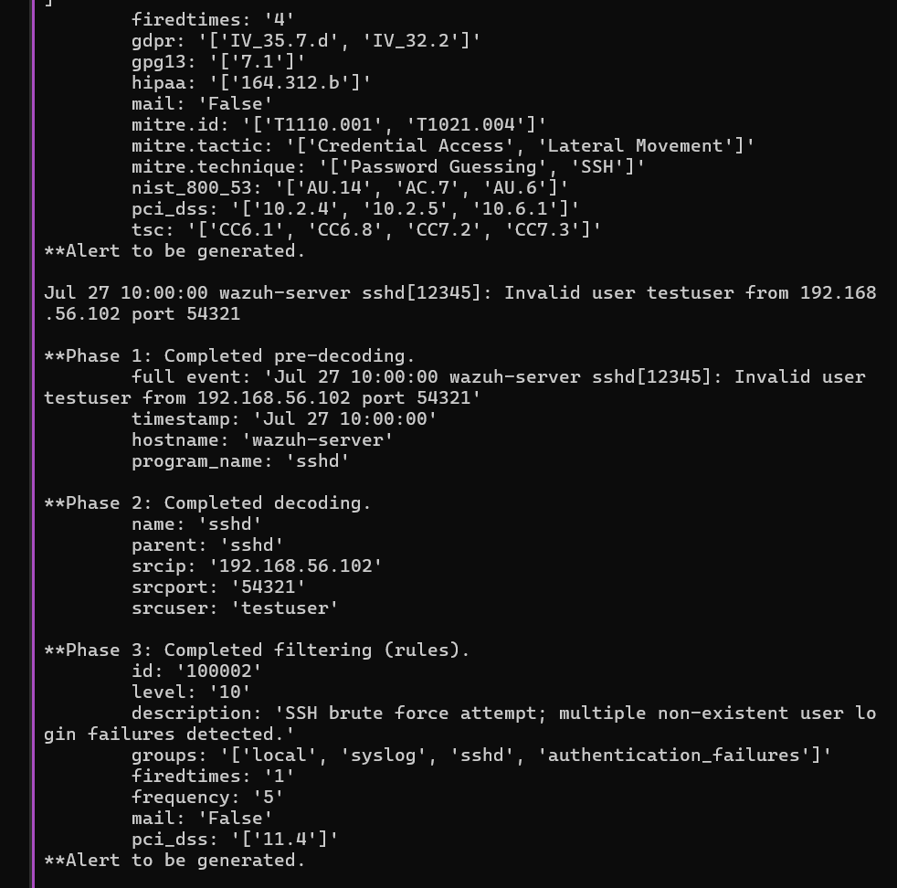
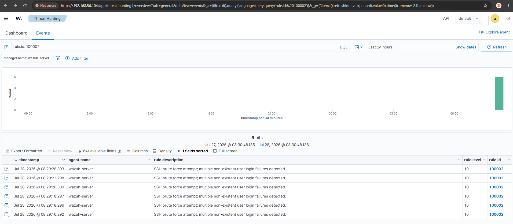

[← README](README.md) · [← Sebelumnya: Deteksi Awal](02-investigasi-deteksi-awal.md) · [Lanjut: Active Response →](04-investigasi-active-response.md)

# Investigasi: Tuning Custom Rule

## Fase 3: Bikin Rule Korelasi Sendiri

**Masalah:** rule noise (`5710`) tetap kepake buat forensik, tapi butuh lapisan deteksi tambahan yang eskalasi lebih cepat dan lebih jelas dibanding nunggu rule bawaan nyala.

**Investigasi:** rule custom ditulis di `/var/ossec/etc/rules/local_rules.xml` (bukan di ruleset default, biar aman dari update Wazuh). ID rule wajib di atas 100000 biar nggak bentrok sama rule bawaan.

```xml
<rule id="100002" level="10" frequency="8" timeframe="120">
  <if_matched_sid>5710</if_matched_sid>
  <description>SSH brute force attempt; multiple non-existent user login failures detected.</description>
  <group>authentication_failures,pci_dss_11.4,</group>
</rule>
```

Divalidasi pakai `wazuh-logtest` sebelum di-deploy ke production, biar nggak perlu restart service tiap kali tes.

```bash
sudo /var/ossec/bin/wazuh-logtest
```



**Temuan:** rule ini awalnya dibuat dengan `frequency=8`, sama kayak rule bawaan `5712`. Tapi setelah dites berkali-kali, rule custom ini **nggak pernah nyala sama sekali** — yang nyala malah tetap `5712`.


Ternyata rule bawaan yang lebih dulu "konsumsi" jendela event yang sama, jadi rule custom nggak kebagian jatah buat eskalasi. Threshold yang sama persis itu bikin rule-nya redundant.

**Kesimpulan:** supaya rule custom beneran kepake dan lebih cepat dari default, threshold-nya diturunin jadi `frequency=5`. Dengan ini, custom rule "menang" lebih dulu dalam korelasi internal Wazuh dibanding rule bawaan.

```xml
<rule id="100002" level="10" frequency="5" timeframe="120">
  <if_matched_sid>5710</if_matched_sid>
  <description>SSH brute force attempt; multiple non-existent user login failures detected.</description>
  <group>authentication_failures,pci_dss_11.4,</group>
</rule>
```



## Fase 4: Validasi di Dashboard dengan Data Nyata

**Masalah:** `wazuh-logtest` cuma simulasi lokal, perlu dipastikan rule-nya beneran jalan pas ada serangan asli masuk ke sistem production.

**Investigasi:** kedua metode serangan (Hydra + script manual) dijalankan ulang, terus dicek di Dashboard pakai query:

```
rule.id: 100002
```



**Temuan:** custom rule nyala **6 kali** di level 10. Angka ini dicek ulang matematisnya — dari 50 percobaan total, cuma 30 yang pakai username nggak valid (sisanya pakai username `wazuh` yang beneran ada, jadi nggak masuk rule `5710`). 30 dibagi 5 (frequency) = 6, pas sama yang muncul di Dashboard.

**Kesimpulan:** custom rule ini kerja sesuai rencana, bukan kebetulan. Deteksi brute force sekarang eskalasi di percobaan ke-5, bukan ke-8 kayak default — alias **37,5% lebih cepat**.

---

[← README](README.md) · [← Sebelumnya: Deteksi Awal](02-investigasi-deteksi-awal.md) · [Lanjut: Active Response →](04-investigasi-active-response.md)
