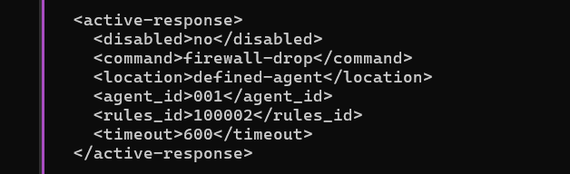
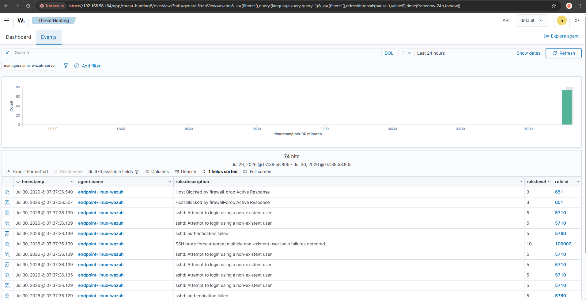
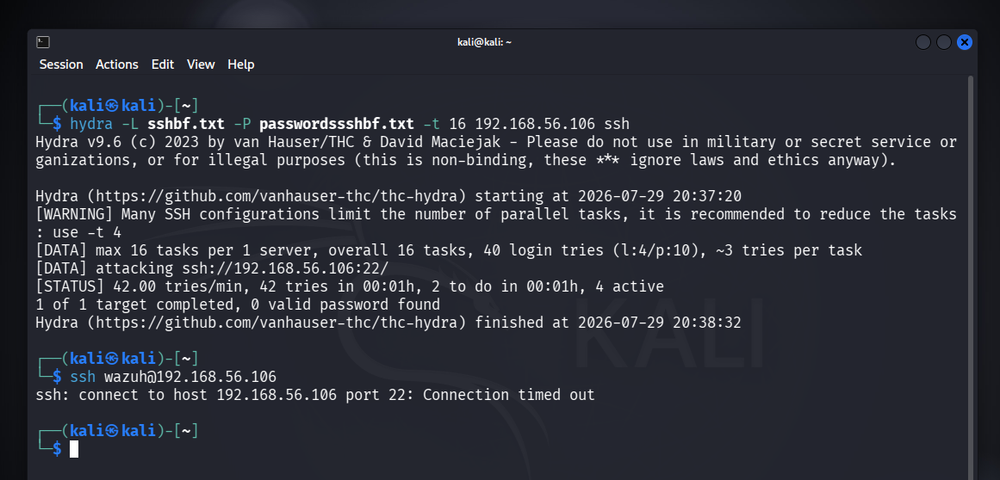
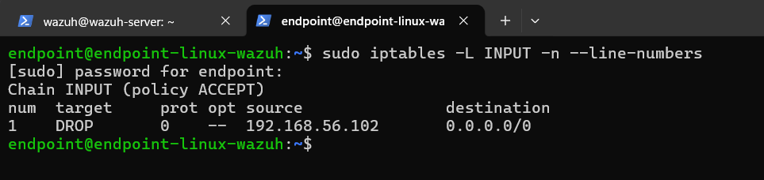
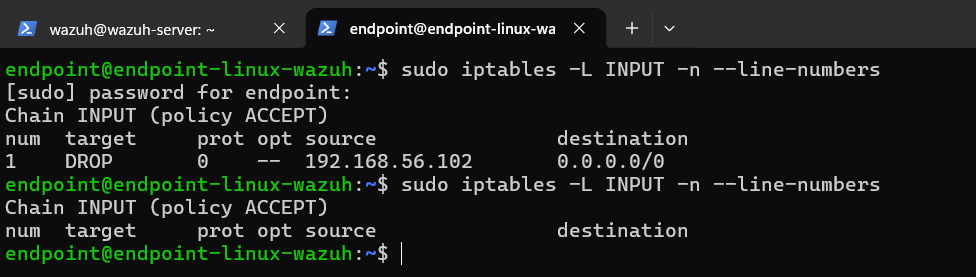
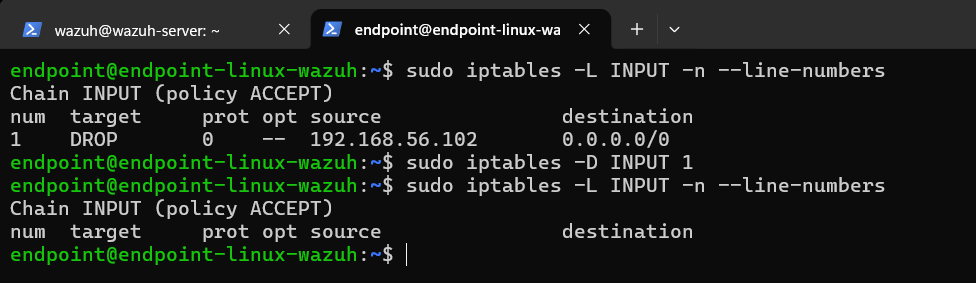
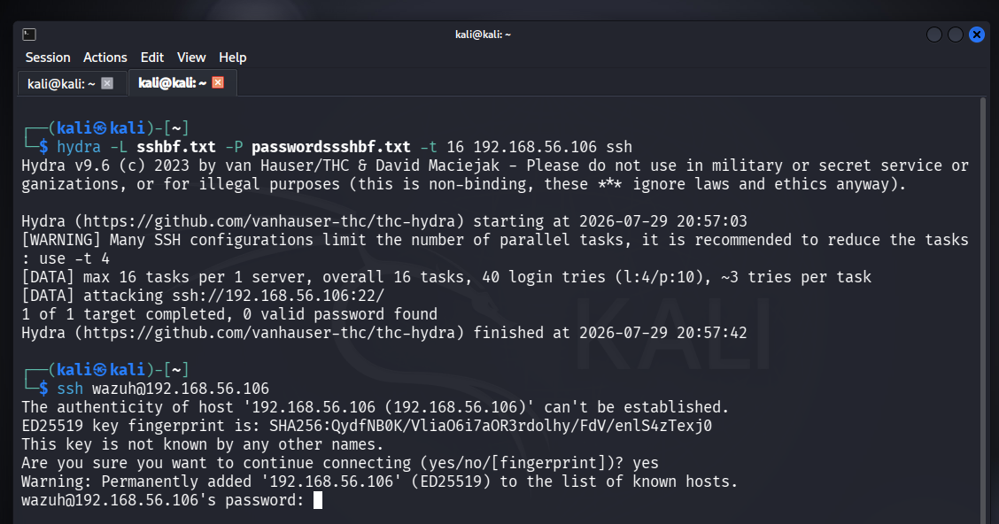

[← README](README.md) · [← Sebelumnya: Tuning Rule](03-investigasi-tuning-rule.md) · [Lanjut: Dampak & Remediasi →](05-analisis-dampak-dan-remediasi.md)

# Investigasi: Containment Otomatis (Active Response)

## Fase 5: Setup Block Otomatis

**Masalah:** deteksi cepat doang belum cukup — kalau nunggu manusia yang block manual, delay-nya masih ada. Perlu containment yang jalan otomatis begitu alert level tinggi muncul.

**Investigasi:** Active Response di Wazuh dieksekusi di sisi agent (host korban), bukan di Manager. Jadi target serangan dipindah dari `wazuh-server` ke `endpoint-linux-wazuh`, biar nggak ada resiko Manager block dirinya sendiri kalau ada salah konfigurasi.

Sebelum diaktifin, whitelist IP penting ditentuin dulu: `192.168.56.104` (Manager), `192.168.56.106` (endpoint sendiri), dan `192.168.56.1` (IP host Windows yang dipakai buat administrasi).

Konfigurasi di `ossec.conf` sisi Manager:

```xml
<active-response>
  <disabled>no</disabled>
  <command>firewall-drop</command>
  <location>defined-agent</location>
  <agent_id>001</agent_id>
  <rules_id>100002</rules_id>
  <timeout>600</timeout>
</active-response>
```



**Temuan:** `firewall-drop` itu command bawaan Wazuh yang udah siap pakai, tinggal dipanggil namanya. Nggak perlu nulis script block sendiri dari nol.

**Kesimpulan:** `location: defined-agent` dipilih dibanding `all` karena masih tahap validasi — lebih aman kalau cakupannya kekontrol ke satu agent spesifik dulu, baru nanti dipertimbangkan `all` kalau udah ada lebih dari satu endpoint yang perlu diproteksi.

## Fase 6: Validasi Block dan Unblock

**Masalah:** perlu dipastikan block-nya beneran jalan, dan yang lebih penting, nggak permanen selamanya.

**Investigasi:** serangan dijalankan ulang ke `endpoint-linux-wazuh`, terus dicek Dashboard dan `iptables` langsung di endpoint.

```bash
sudo iptables -L INPUT -n --line-numbers
```

**Temuan:** urutan deteksinya ketauan jalan lengkap — rule `5710` (noise) → `100002` (korelasi hasil tuning) → **`651` (Host Blocked by firewall-drop Active Response)**.



Begitu block aktif, percobaan SSH berikutnya dari Kali langsung hang tanpa pesan error. Ini normal karena `iptables DROP` yang dipakai Wazuh beda dari `REJECT` — paket dibuang diam-diam, attacker nggak dikasih tau kalau dia keblokir.




Dicek lagi beberapa menit kemudian, rule block-nya udah hilang sendiri — konfirmasi timeout 600 detik jalan otomatis tanpa perlu diapa-apain.



Buat ngetes jalur manual juga, serangan dipicu ulang terus block-nya dihapus manual sebelum timeout:

```bash
sudo iptables -D INPUT 1
```




**Kesimpulan:** siklus containment-nya lengkap — block otomatis pas ada ancaman, auto-unblock setelah waktu tertentu, dan tetap ada opsi override manual kalau admin butuh buka lebih cepat atau tahan lebih lama. Nggak ada resiko IP keblokir permanen tanpa sengaja.

---

[← README](README.md) · [← Sebelumnya: Tuning Rule](03-investigasi-tuning-rule.md) · [Lanjut: Dampak & Remediasi →](05-analisis-dampak-dan-remediasi.md)
